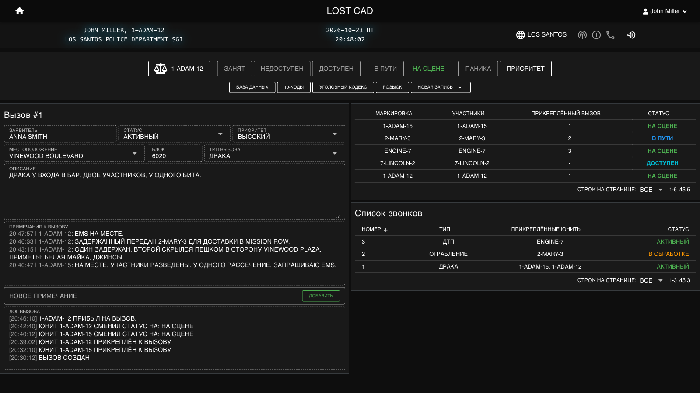
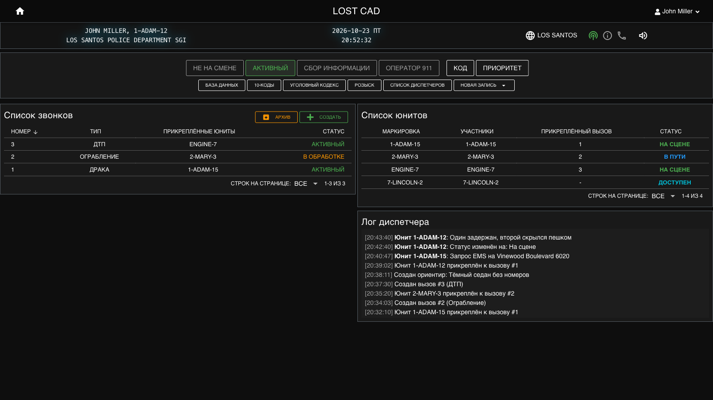
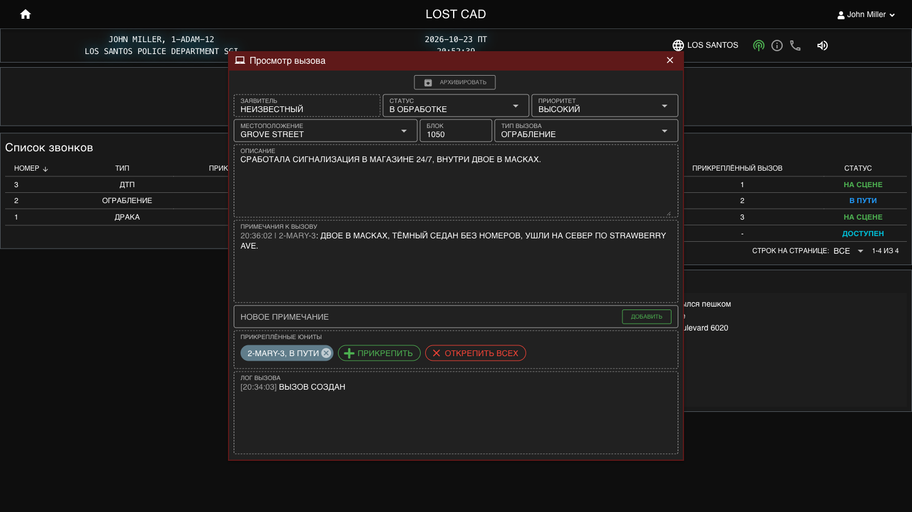
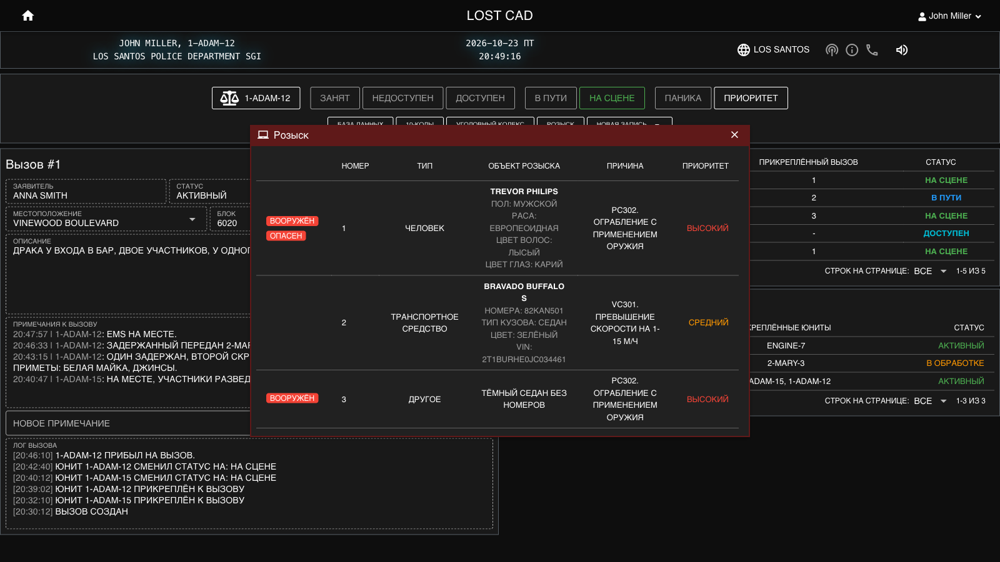
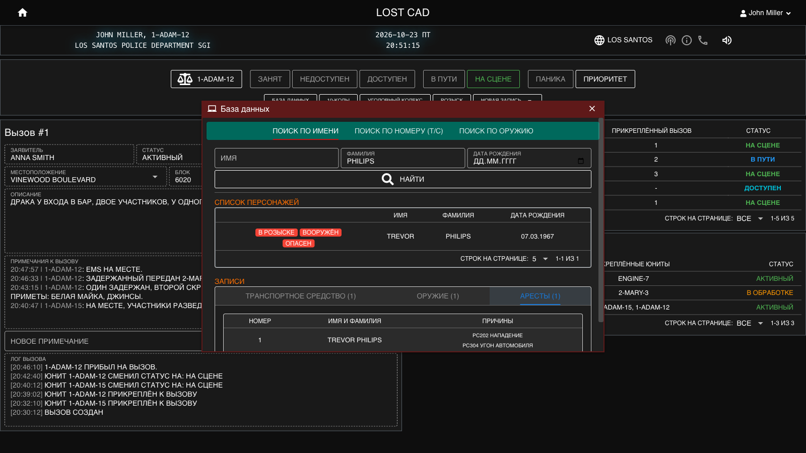
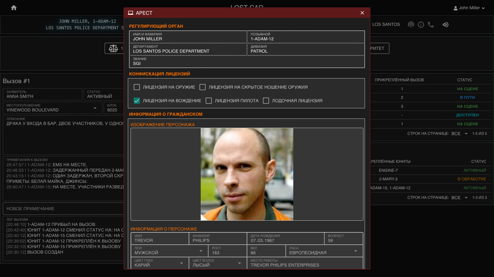
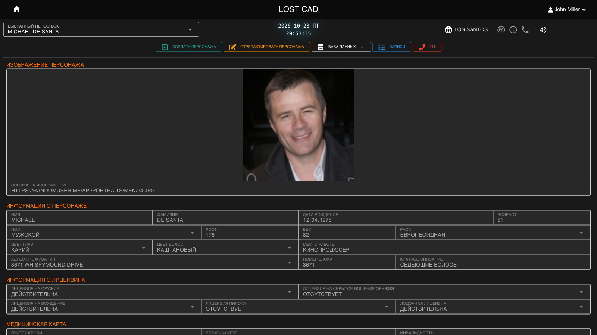
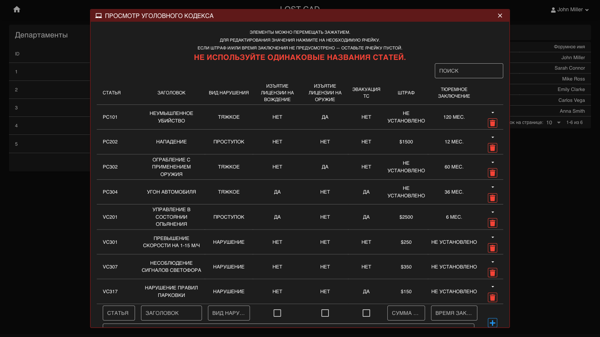
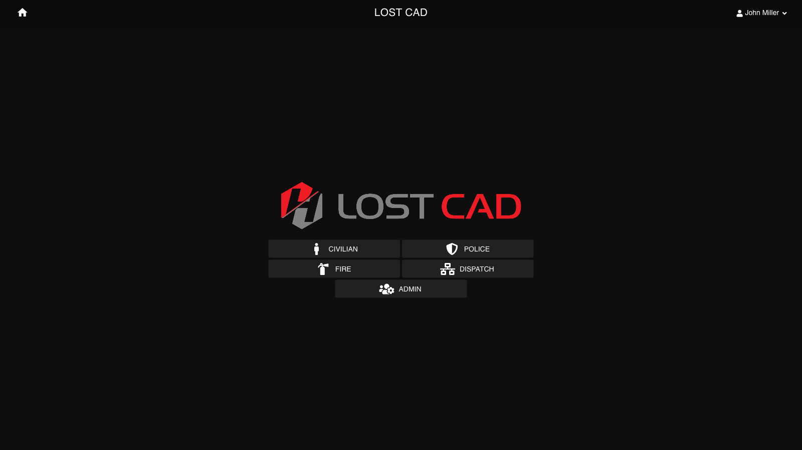

# Lost CAD

A CAD/MDT (Computer Aided Dispatch / Mobile Data Terminal) for a GTA roleplay server: a dispatcher workstation, an in-car terminal for police and fire units, a database of civilian characters and an admin panel. Built in 2021 as the second version of [Console](https://github.com/fl0w3rs/console), rewritten as a single-page app where every change reaches all clients in real time. The interface is in Russian.



## Screenshots

| | |
|---|---|
|  Dispatcher workstation |  Call card |
|  BOLOs |  Database lookup |
|  Arrest report |  Civilian character |
|  Penal code editor |  Department selection |

## Features

- **Dispatch**: calls with notes and an action log, attaching units, dispatcher duty statuses, the dispatcher log, Signal 100 and priority traffic.
- **Units**: officers pick an identifier (name, callsign, department, rank), create or join a unit and update its status. Panic, priority traffic, new calls and unit attachments play sound alerts.
- **Records**: BOLOs for people, vehicles and anything else, citations, arrests and vehicle impoundments. Charges come from the penal code, and licences can be revoked as part of an arrest.
- **Lookups**: search characters by name, vehicles by plate and weapons by serial, with the character's records and active BOLOs.
- **Civilians**: characters with photos, medical records, licences, vehicles and weapons.
- **Admin**: departments with their divisions, ranks and forum groups, the penal code and 10-codes (drag to reorder), users and their action log.
- **Forum login**: sign-in uses the IPS4 forum session cookie. Access to each department comes from the user's forum groups.
- **Game integration**: the game server can poll `/api/getUnitLoad`, `/api/getCode` (Signal 100) and `/api/getGameZone`.

## Stack

- **Frontend:** Vue 3, [Quasar](https://quasar.dev/) 2, Vuex, TypeScript in places, socket.io-client.
- **Backend:** Node.js, Express, [Socket.IO](https://socket.io/) 4, Sequelize with MariaDB, bundled with esbuild.

## Structure

```
buildTools.js          builds the backend (esbuild) and the frontend (Quasar)
backend/
  main.js              Socket.IO server, HTTP API, shared helpers
  config.js            settings, read from environment variables
  db/                  Sequelize models for the CAD and forum databases
  messages/            one file per Socket.IO message: calls, units, bolos, lookup…
  helpers/             cache and validation rules
frontend/
  src/pages/           police, fire, dispatch, civilian and admin screens
  src/components/      windows, record forms, tables
  src/store/           Vuex modules
  src/boot/            socket connection and request/response wrapper
```

Each file in `backend/messages/` exports a message name and a handler. `buildTools.js` bundles them into `dist/index.js` with an import glob, so adding a message means adding a file.

## Running

Requires Node.js 18, Yarn 1 and MariaDB. Users come from an IPS4 forum database: the backend reads `core_members`, `core_members_known_devices` (the `login_key` from the forum's login cookie), `core_groups` and `core_sys_lang_words`.

1. Install dependencies with `yarn install` in the repository root, `backend/` and `frontend/`.
2. Copy `backend/.env.example` to `backend/.env` and fill in the CAD and forum database credentials. With `DB_SYNC=1` the backend creates the CAD tables on start.
3. Backend: `node buildTools.js buildBackend`, then `node dist/index.js` (port 9669) with the variables from `.env` exported.
4. Frontend: `npx quasar dev` in `frontend/`. The dev server proxies `/api` and `/socket` to the backend, set `API_URL` if it is not on `localhost:9669`.

For production, `node buildTools.js build` builds both parts into `dist/`. Serve `dist/front` and proxy `/api` and `/socket` to the backend on the same domain as the forum, so the browser sends the login cookie.
